# Kuis Ilkom

Aplikasi kuis pilihan ganda seputar ilmu komputer yang dibuat dengan Flutter. Proyek ini dikerjakan untuk UTS Pemrograman Mobile (PM 2), Semester Ganjil T.A. 2026/2027, Unit Ilmu Komputer Laboratory Center (IKLC), Program Studi Ilmu Komputer, Fasilkom-TI Universitas Sumatera Utara.

## Identitas Mahasiswa

| |                   |
|---|-------------------|
| Nama | Nazwa Tri Mifthah |
| NIM | 241401106         |
| Lab | PM 2              |

## Informasi Aplikasi

**Nama aplikasi:** Kuis Ilkom

**Deskripsi singkat:** Kuis Ilkom adalah aplikasi kuis pilihan ganda untuk berlatih materi kuliah ilmu komputer. Pengguna membuat akun, memilih mata kuliah, mengerjakan soal, lalu melihat skor akhir beserta pembahasan. Selain kuis biasa, ada level dan XP, lencana, streak harian, tantangan harian, dan papan peringkat antar akun di perangkat yang sama.

### Fitur yang tersedia

**Akun dan profil**
- Register dan login. Setelah register berhasil, pengguna dikembalikan ke halaman login dengan username yang sudah terisi.
- Sesi login tersimpan, jadi pengguna tidak perlu login ulang setiap membuka aplikasi.
- Profil: ganti avatar, ubah nama, ganti password, dan tombol keluar.

**Kuis**
- 19 mata kuliah ilmu komputer dengan 190 soal (10 soal per mata kuliah).
- Pencarian mata kuliah dan filter berdasarkan semester.
- Pengaturan sebelum mulai: jumlah soal, mode latihan atau ujian, dan timer per soal.
- Mode latihan menampilkan koreksi langsung (benar atau salah) beserta penjelasan. Mode ujian baru dikoreksi di halaman hasil.
- Urutan soal diacak setiap kuis dimulai.
- Kuis yang belum selesai bisa dilanjutkan dari Beranda.

**Hasil dan pembahasan**
- Skor akhir dalam bentuk lingkaran animasi, penilaian bintang, dan persentase.
- Pembahasan seluruh soal atau hanya soal yang salah.
- Tombol untuk mengulang khusus soal yang salah.

**Perkembangan pengguna**
- Level dan XP (10 XP per jawaban benar, bonus 20 XP untuk nilai sempurna).
- 13 lencana yang terbuka otomatis berdasarkan riwayat kuis.
- Streak harian beserta kalender 7 hari terakhir.
- Tantangan Harian: 5 soal yang sama untuk semua akun pada hari itu, 20 detik per soal, bonus XP 2x, dan hanya bisa dikerjakan sekali sehari.
- Papan peringkat lokal (semua waktu atau 7 hari terakhir) dengan podium tiga besar.
- Halaman statistik per mata kuliah, termasuk mata kuliah yang paling dikuasai dan yang perlu lebih banyak latihan.

**Tampilan**
- Mode terang dan gelap, pilihan tema tersimpan.
- Tata letak adaptif: bar navigasi di bawah pada layar sempit, dan navigation rail di samping pada tablet atau browser.

### Daftar mata kuliah

| Semester | Mata kuliah |
|---|---|
| 1-2 | Pengantar Ilmu Komputer, Algoritma & Pemrograman, Matematika Diskrit, Struktur Data |
| 3-4 | Basis Data, Pemrograman Berorientasi Objek, Arsitektur Komputer, Sistem Operasi, Pemrograman Web, Desain & Analisis Algoritma |
| 5-6 | Jaringan Komputer, Rekayasa Perangkat Lunak, Kecerdasan Buatan, Keamanan Informasi, Pemrograman Mobile, Interaksi Manusia & Komputer, Teori Bahasa & Otomata |
| 7-8 | Komputasi Awan & DevOps, Sains Data |

## Pemenuhan Kriteria Soal

| No | Kriteria | Penerapan di aplikasi |
|---|---|---|
| 1 | StatelessWidget dan StatefulWidget | Halaman yang punya input atau state lokal memakai StatefulWidget (login, register, beranda, kuis, hasil, peringkat). Tampilan murni dan komponen kecil memakai StatelessWidget. |
| 2 | Minimal 2 halaman dan navigasi | Login, Register, Beranda, Kuis, Hasil, Peringkat, Statistik, Profil, dan Lencana. Navigasi memakai `Navigator.push`, `pushReplacement`, `popUntil`, dan bottom navigation. |
| 3 | Widget reusable di file terpisah | Folder `lib/widgets/` berisi tombol, kolom input, kartu mata kuliah, opsi jawaban, indikator progres, podium, dan komponen lain yang dipakai di beberapa halaman. |
| 4 | Aset gambar atau ikon | Banner di `assets/images/` dan Material Icons di seluruh aplikasi. |
| 5 | Font kustom | Poppins (Regular, SemiBold, Bold) di `assets/fonts/`, diatur sebagai font tema. |
| 6 | Ukuran dinamis | Semua ukuran dihitung dari lebar layar lewat helper `Responsive` (`wp`, `hp`, `sp`). Isi halaman berada di dalam `ContentWrapper` yang bisa di-scroll agar tidak overflow. |
| 7 | State management | Provider. `AuthProvider` dan `QuizProvider` dipasang di root aplikasi sehingga progres jawaban dan timer tidak hilang saat layar dirotasi atau berpindah halaman. |
| 8 | Tanpa database | Soal tersimpan lokal di `lib/data/`. Akun, riwayat skor, dan tema disimpan dengan `shared_preferences`. |
| 9 | GitHub sebagai pelacak kemajuan | Commit dilakukan per fitur, bisa dilihat di riwayat commit repository ini. |
| 10 | Desain bebas | Lihat daftar fitur di atas. |
| Bonus 1 | Dual theme | Mode terang dan gelap, bisa diganti dari beranda atau profil. |
| Bonus 2 | Adaptive dan responsive | Layout memakai bar bawah di layar sempit dan navigation rail di layar lebar, dengan lebar konten dibatasi agar tetap proporsional. |

## Struktur Proyek

```
lib/
├── main.dart                  # titik masuk, MultiProvider, tema, AuthGate
├── data/
│   ├── courses.dart           # daftar mata kuliah
│   ├── questions.dart         # penggabung semua soal + fungsi pengacakan
│   ├── questions_dasar.dart   # soal semester 1-2
│   ├── questions_menengah.dart
│   ├── questions_lanjut.dart
│   ├── questions_tambahan.dart
│   ├── daily_challenge.dart   # aturan tantangan harian
│   └── avatars.dart           # pilihan avatar
├── models/                    # Question, ScoreEntry, Course, QuizSettings
├── providers/
│   ├── auth_provider.dart     # akun, sesi, profil
│   └── quiz_provider.dart     # jalannya kuis, timer, riwayat, tema
├── screens/                   # halaman-halaman aplikasi
├── widgets/                   # komponen UI yang dipakai ulang
├── theme/app_theme.dart       # warna dan tema terang/gelap
└── utils/                     # responsive, gamification, achievements, leaderboard
assets/
├── fonts/                     # Poppins
└── images/                    # banner
```

## Teknologi

- Flutter dan Dart
- [provider](https://pub.dev/packages/provider) untuk state management
- [shared_preferences](https://pub.dev/packages/shared_preferences) untuk penyimpanan lokal
- Font Poppins

## Cara Menjalankan

```bash
git clone [https://github.com/nazwatrimiftah03/kuispilgan_pm2.git]
cd [KuisPilganPM2]
flutter pub get
flutter run
```

Untuk mencoba tampilan tablet atau browser: `flutter run -d chrome`.

## Dokumentasi

### Credit aset

| Aset | Sumber                             | Lisensi |
|---|------------------------------------|---|
| Font Poppins | Google Fonts (Indian Type Foundry) | SIL Open Font License 1.1 |
| Ikon | Material Icons, Google             | Apache License 2.0 |
| Gambar banner | Google                             |

### Screenshot tiap halaman

| Halaman | Tampilan |
|---|---|
| Login | 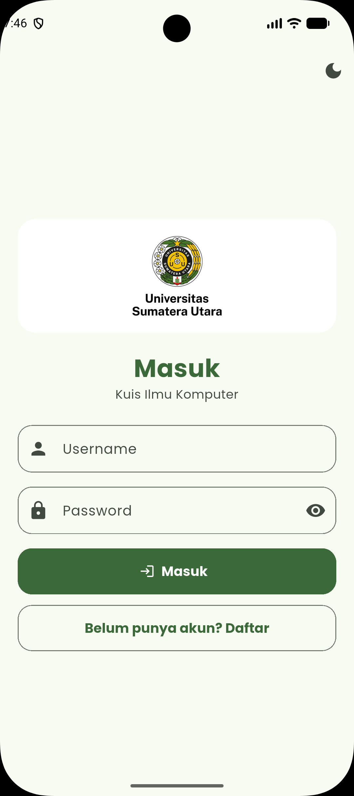 |
| Register | 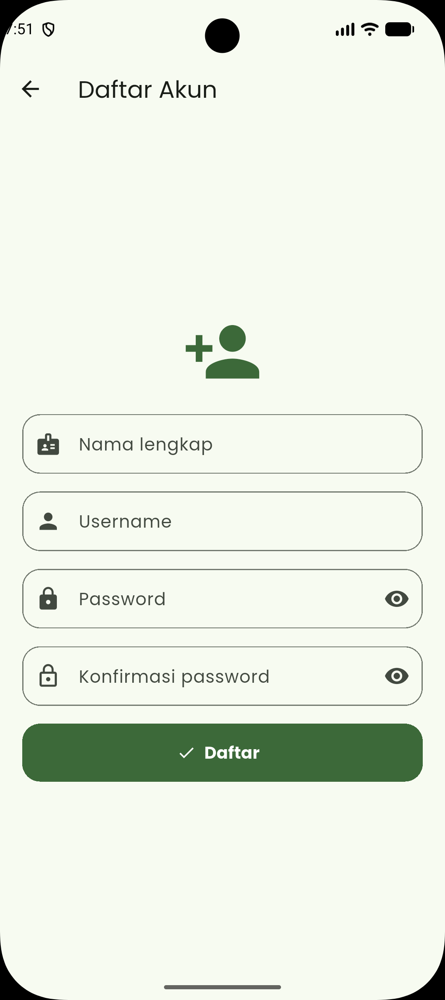 |
| Beranda |  |
| Pengaturan kuis | 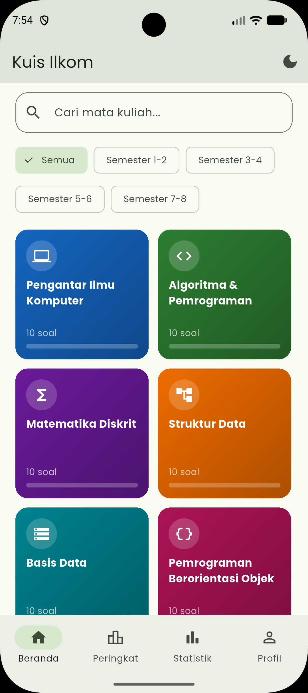 |
| Kuis (mode ujian) | 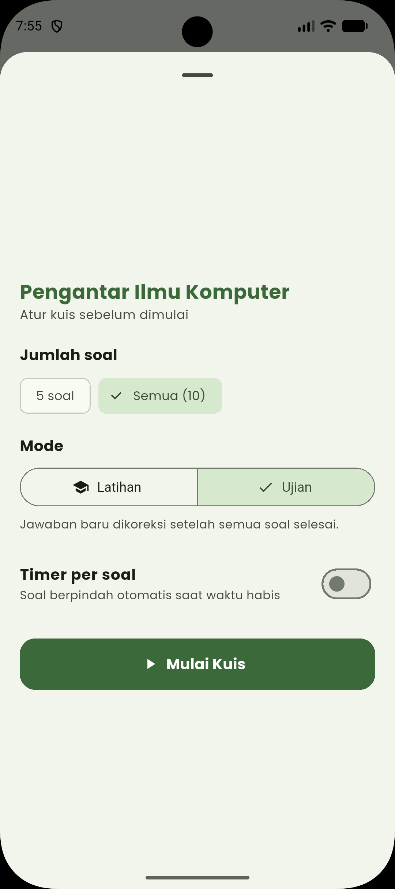 |
| Kuis (mode latihan) | 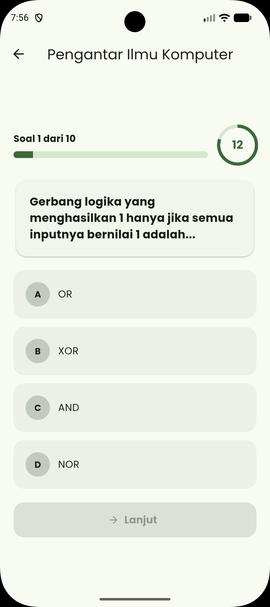 |
| Hasil kuis | 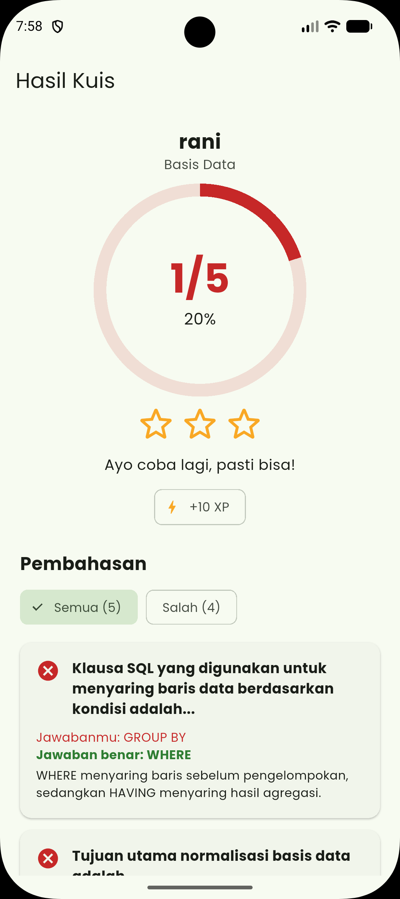 |
| Papan peringkat | 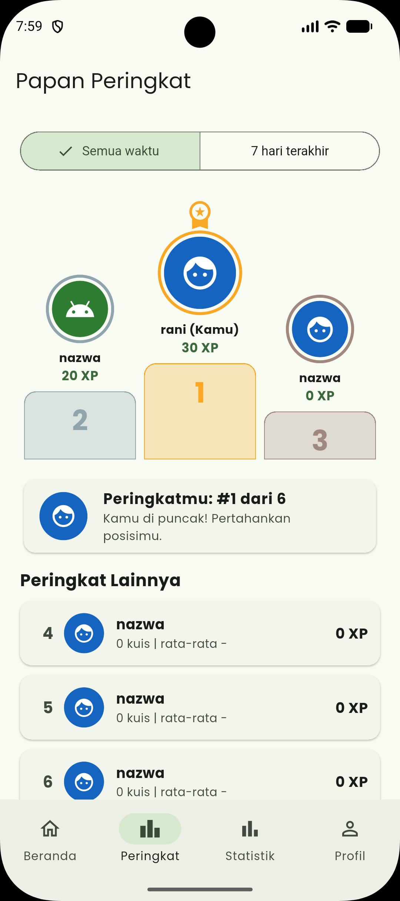 |
| Statistik | 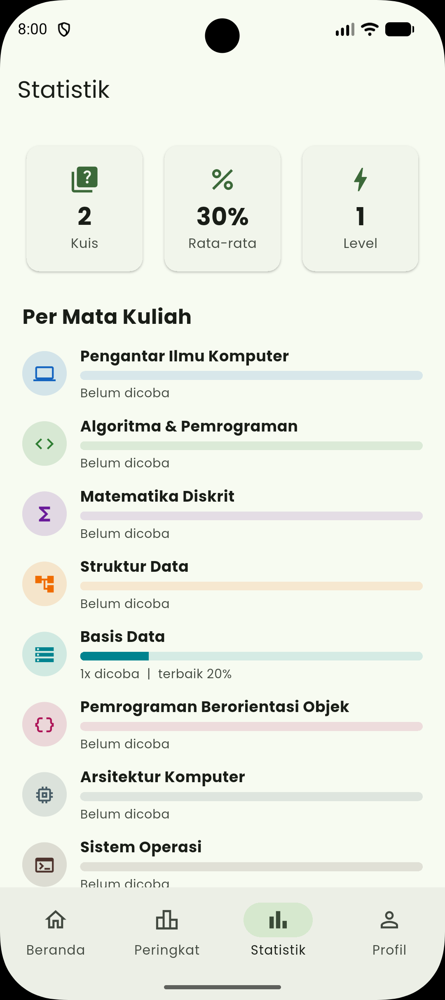 |
| Profil | 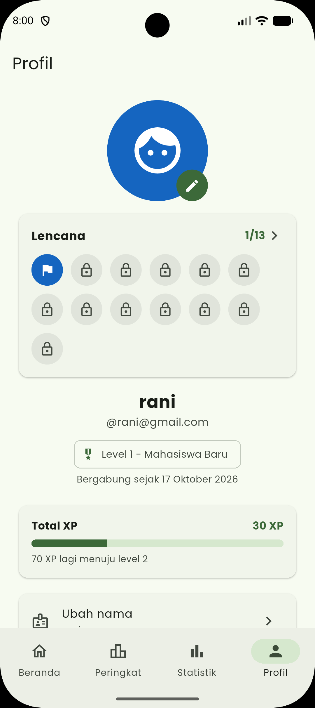 |
| Lencana | 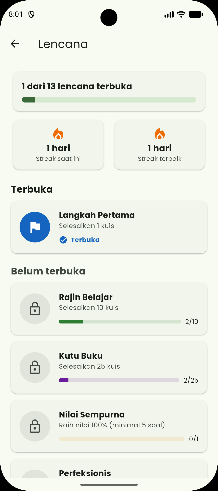 |
| Mode gelap | 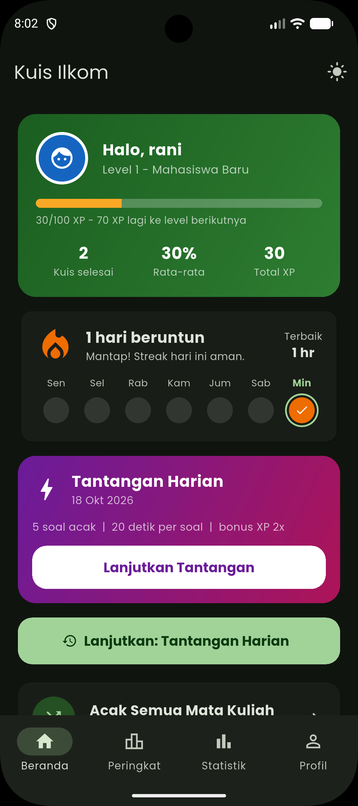 |
| Tampilan tablet atau browser | 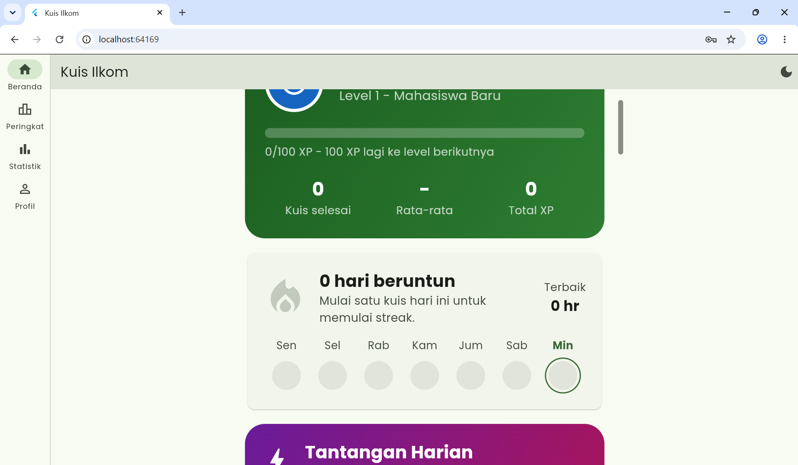 |

## Catatan dan Keterbatasan

- Password disimpan apa adanya di penyimpanan lokal karena aplikasi ini tidak memakai server. Pada aplikasi sungguhan, password harus di-hash dan diproses di sisi server.
- Papan peringkat hanya membandingkan akun yang terdaftar di perangkat yang sama.
- Karena data disimpan lokal, menghapus data aplikasi atau mencopot pemasangan akan menghapus akun dan riwayat skor.
- Soal bersifat lokal (dummy) dan tersimpan di `lib/data/`.